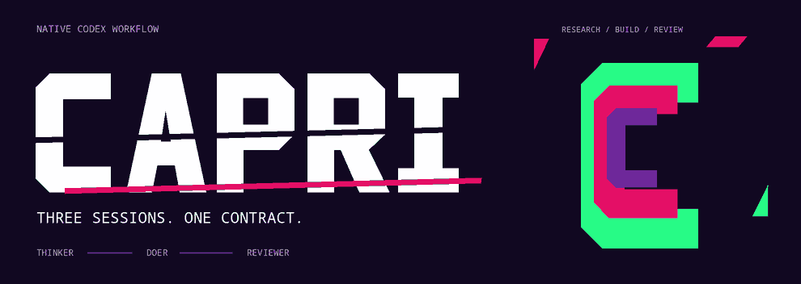
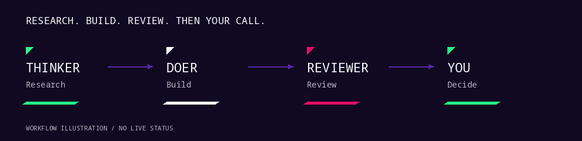

<div align="center">

<a href="docs/README_STATIC.md"></a>

# CAPRI

**Three sessions. One contract.**

Research, scoped implementation and independent review in separate native Codex sessions.
One experimental controller keeps the handoffs explicit. The final call stays yours.

[Quickstart](#quickstart) · [Workflow](#how-it-works) · [Current limits](docs/STATUS.md) · [Contribute](docs/CONTRIBUTING.md) · [Credits](docs/ASSETS.md)

**Public development preview** · [Actual CI runs](https://github.com/Denoax/capri/actions/workflows/tests.yml) · [Static version](docs/README_STATIC.md)

</div>

## Research. Build. Review. Then your call.

CAPRI gives each role a separate native Codex context: a Thinker to research and scope the work, a Doer to implement within a candidate, and a fresh Reviewer to inspect the sealed result. Frozen instructions, source identities, scoped writes and collector checks bind the handoffs. Role names and model messages grant no authority to approve work.



*An authored workflow illustration, not application footage or live status. See the [static diagram](showcase/capri/workflow-static.png).*

## How it works

| Role | Responsibility |
| --- | --- |
| Thinker | Research the task and prepare its scoped contract |
| Doer | Read frozen inputs and work inside the permitted candidate |
| Reviewer | Independently inspect the sealed candidate and evidence |
| You | Make the exact, source-bound accept / revise / reject decision |

The three roles use `gpt-6.1-sol`; effort settings are role-specific. Only one role owns candidate writes. Completed formal outcomes stop at `AWAITING_HUMAN`. A report, passing test or public export never supplies that decision, and no successor task starts automatically.

## Quickstart

Start with offline inspection. Requires **Python 3.11+**, Linux and working **bubblewrap user, mount, PID and network namespaces** for the complete suite.

```sh
git clone https://github.com/Denoax/capri.git
cd capri
python3 -m venv .venv
. .venv/bin/activate
python -m pip install --require-hashes -r requirements.lock
PYTHONDONTWRITEBYTECODE=1 python -m unittest discover -s controller/tests -v
```

The tests do not call models or need authentication. Installing bubblewrap alone does not prove confinement; CI probes the actual collector before running the full suite. Namespace failures remain failures. The [setup guide](docs/QUICKSTART.md) explains prerequisites and the boundary before an experimental native run.

## Keep the thread

Context counters, checkpoints and recovery controls make recorded state inspectable. They distinguish cumulative usage and recent-request footprint from **unknown exact context occupancy**. Checkpoints bind source, instructions, questions, uncertain effects and role lineage; stale or unsupported state holds work for reconciliation.

This is a fixed source export from `6a6c3ee`, with the executable code preserved byte-for-byte. It does not track a moving development branch. The original [implementation README](IMPLEMENTATION_README.md), [architecture](ARCHITECTURE.md) and [source record](docs/SOURCE.md) remain available.

**Still experimental:** live native lifecycle, selector/recovery qualification, tmux behavior and the eight-trial comparison remain pending at this cutoff. The snapshot includes inherited offline evidence; this presentation adds no runtime qualification. No source-bound documentary demo is published. Read [current status](docs/STATUS.md) before evaluating it.


## Contribute

Found a loose wire? Bring a repro. Keep the patch narrow, preserve failed checks, and name the source you tested. Start with the [contribution guide](docs/CONTRIBUTING.md), [roadmap](ROADMAP.md) and [security boundaries](SECURITY.md).

## Credits

Created by **Mani Marami Milani**. Capri-inspired, unofficial presentation; no affiliation or endorsement by CD PROJEKT RED, TRIGGER or Netflix. The geometric lettering and motion are original authored code. [Asset credits and reproducible exports](docs/ASSETS.md).

**Code and original asset license selection is pending.** Public source availability does not grant an open-source license; inherited notices are preserved. [License status](docs/LICENSE_STATUS.md).
